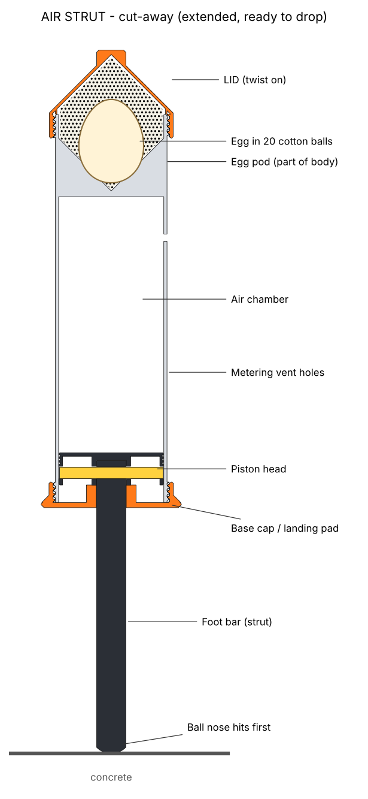

# AIR STRUT: pneumatic egg lander

## 1. The idea

AIR STRUT works like a plane's landing-gear shock absorber, but it uses air instead of oil.

- It always lands foot-first. The ball nose of a light foot bar (69 g) touches the concrete first and stops there.
- The heavy body, with the egg on top (342 g in total), keeps falling. It slides 15 cm down the bar.
- While it slides, the piston head pushes air out of a 72 mm air chamber through 17 small diamond holes. The piston covers the holes one after another, so fewer holes stay open as the body slows down. This keeps the braking force close to even all the way, instead of one hard spike.
- The air takes the energy and turns it into heat, so the capsule doesn't bounce back the way a spring would. Nothing breaks or gets crushed, so the capsule is ready to use again straight away.
- At the end, the body settles on its wide orange base (96 mm), so it stays standing and doesn't tip over onto the egg.
- The egg sits pointy end down in a cone-shaped pod, packed tight in 20 cotton balls. The cotton spreads the load over the whole shell.

Simulated peak load on the egg (two-body model with air flow, with the real part weights and the real vent holes):

| Drop | Normal case | Worst of the "print is a bit off" cases |
|---|---|---|
| 4 ft / 1.2 m | 18 g | 27 g |
| 8 ft / 2.4 m | 31 g | 39 g |
| 12 ft / 3.7 m | 45 g | 56 g |
| 20 ft / 6 m | 68 g | 86 g |

A bare egg on concrete takes thousands of g. The "worst" cases change hole flow ±20%, leak around the piston ×0.5 to ×1.6, bounce, weights ±20%, cotton packing and friction.

## 2. Files (`stl/`), already in print position

| # | File | Part |
|---|---|---|
| 1 | `1_body.stl` | Air chamber + egg pod (one piece) |
| 2 | `2_base_cap.stl` | Landing base, bar guide, screws on the bottom |
| 3 | `3_piston_head.stl` | Piston |
| 4 | `4_foot_bar.stl` | Foot bar with ball nose |
| 5 | `5_pin.stl` | Square pin (joins bar and piston) |
| 6 | `6_lid.stl` | Screw-on lid with grip knob |

The source code is in `tools/`: `parts.py` (CAD), `simfast.py` + `optimize.py` (drop simulation).

## 3. Print settings (PLA, 0.4 mm nozzle, no supports on any part)

Load each file as it is, without rotating it.

| Part | Position on plate | Layer | Walls | Infill | Extra | Time | Grams |
|---|---|---|---|---|---|---|---|
| Body | open rim down (as in file) | 0.24 | 5 | 10% gyroid | **8 mm brim** (tall part) | 2 h 37 | 202 |
| Base cap | flat disc down | 0.20 | 4 | 25% gyroid | | 0 h 47 | 38 |
| Piston head | flat face down | 0.20 | 4 | 15% gyroid | | 0 h 33 | 28 |
| Foot bar | lying flat | 0.20 | 4 | 15% gyroid | lying flat makes it 2-3x stronger | 0 h 49 | 37.5 |
| Pin | lying flat | 0.20 | 3 | 100% | | 0 h 04 | 3 |
| Lid | open rim down | 0.20 | 4 | 15% gyroid | | 0 h 31 | 35 |

Top layers 5, bottom layers 4. Plate A holds the body only. Plate B holds the other five parts.

**Estimate: about 5 h 20 min and about 343 g.** This comes from a slicer set up with K1 Max speeds and accelerations. If Creality Print shows more than 9 h, tell me.

## 4. Assembly (no glue, tape or screws)

1. **Foot:** push the square end of the bar into the square socket under the piston head. Line up the diamond holes and push the pin all the way through. The pin can't fall out later, because the chamber wall covers both ends.
2. **Into the body:** turn the body upright, with the egg pod on top. Slide the piston head, flat face first, up into the open bottom of the body. The bar hangs out of the bottom.
3. **Base cap:** slide the cap over the bar (square hole), threads facing up. Screw it onto the bottom of the body until it stops.
4. **Check:** hold the body upright. The foot should slide freely and fall out by its own weight. If you push the foot in fast, you should feel a soft air cushion. If it rubs, lightly sand the edge of the piston head. It must never stick.

## 5. Cotton balls (all 20 go in the egg pod)

Never put cotton in the air chamber or over the vent holes.

1. Unscrew the lid.
2. Put **6 cotton balls** into the cone at the bottom of the pod and press them down lightly.
3. Put the egg in **pointy end down**, in the centre.
4. Push **8 cotton balls** around the sides of the egg, all the way round.
5. Put **6 cotton balls** on top.
6. Screw the lid on until it stops. It squeezes the top cotton. The egg must not move when you shake the capsule. If it moves, add the spare cotton fluff.

## 6. How to drop it

- **Foot down, lid up.** Pinch the knob on top of the lid with your fingertips. The capsule hangs straight down by itself, with the foot fully out.
- Wait for it to stop swinging. Open your fingers. Don't throw it, push it or spin it.
- It lands on the ball nose. The body sinks down the strut with a "pfff" of air and stands on its orange base.
- **Between drops:** lift it by the lid knob, and the foot slides back out. Check that the 17 vent holes are clear and the foot slides freely. Then put in the new egg.

## 7. Why this design (engineering notes)

- **PLA can't be a spring here.** Stiff PLA can only store about 20 to 40 J/kg without cracking. To stop a capsule falling at 10.6 m/s you need 56 J/kg. Any PLA spring big enough would weigh more than the whole capsule, and it would also throw the egg back up.
- **Air can do it.** Air weighs nothing, can't break and doesn't bounce back much when it leaks out through holes. The vent pattern was tuned by simulation for all four drop heights at once.
- **The body is heavy and the foot is light.** That way the hard hit on the concrete only affects the 69 g foot. The body, the egg and every thread brake at about 60 g, so no PLA part takes a hard shock.
- **The foot can't creep in during the fall.** The wide flat base has much more air drag for its weight than the slim foot. So the air pulls the foot outward during the fall, and it stays fully out until impact.
- **No part is thin.** The main walls are at least 2.2 mm. The threads are coarse (4 mm pitch, 1.5 mm deep) with 0.3 mm clearance, and I checked they turn without touching. The bar is printed lying down, because a bar printed standing up can snap along its layer lines if it lands at an angle.
