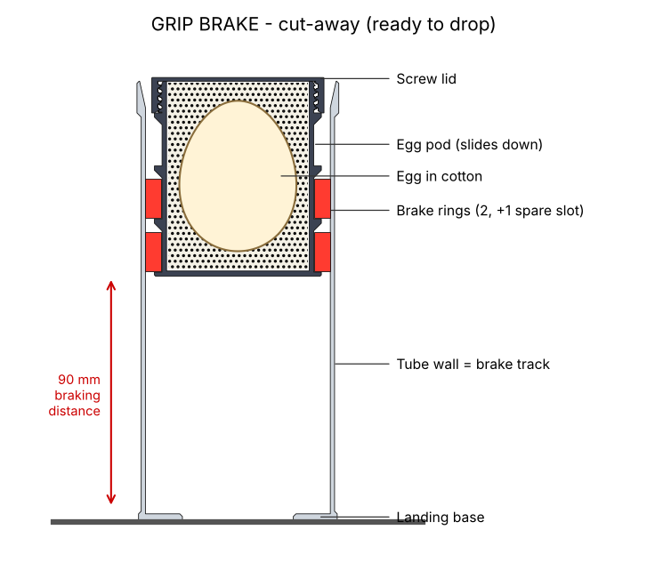

# GRIP BRAKE: friction-brake egg capsule

## 1. The idea

GRIP BRAKE works like the emergency brake that stops a falling elevator: brake shoes squeeze a rail and friction turns the speed into heat.

- It's a small tube (7.6 cm wide, 16.7 cm tall). The egg sits in a pod at the top of the tube, packed in cotton.
- The pod carries **2 red brake rings**. Each ring is a C-shaped spring that pushes outward on the tube wall with about 240 N.
- **On impact:** the tube stops on the ground, and the pod keeps going down. The rings rub along the tube wall and friction slows the pod over up to 9 cm. The braking force stays the same all the way, so the egg gets a smooth, even push instead of a hard hit.
- Friction doesn't spring back, so the pod doesn't bounce. Nothing breaks, so the capsule can be used again: push the pod back up and drop again.
- This isn't air: the tube is open at both ends, so no air gets squeezed.

**Honest comparison with AIR STRUT:** a small capsule has a short braking distance, so the egg feels about 100–140 g at every height (simulated), against 18–68 g in AIR STRUT. It's good for 4, 8 and 12 ft. 20 ft is possible but riskier, so do the 4 ft test in section 6 first.

## 2. Files

| # | File | Part |
|---|---|---|
| 1 | `stl/1_tube.stl` | Tube with landing base (the brake track) |
| 2 | `stl/2_egg_pod.stl` | Egg pod with 3 ring slots |
| 3 | `stl/3_pod_lid.stl` | Screw lid for the pod |
| 4 | `stl/4_brake_ring.stl` | Brake ring: **print 2** (a 3rd only if the test says so) |

**Creality Print project:** `GRIP_BRAKE_K1Max.3mf` (File > Open Project). It's set up for the K1 Max 0.4 nozzle with Hyper PLA, on 2 plates, with every setting below already set per part.

## 3. Print settings (PLA, no supports)

| Part | Position | Layer | Walls | Infill |
|---|---|---|---|---|
| Tube | base down, 5 mm brim | 0.28 | 4 | 15% gyroid |
| Egg pod | floor down | 0.24 | 4 | 15% gyroid |
| Lid | flat top down (as in file) | 0.24 | 4 | 15% gyroid |
| Brake ring ×2 | flat | 0.24 | 7 | **100% (solid)** |

The rings must be solid, because their stiffness sets the braking force.

**Estimate: about 3 h 05 min and 185 g** (Plate A, the tube: 1 h 32. Plate B, pod + lid + 2 rings: about 1 h 35). A 3rd ring adds about 20 min. These times come from another slicer using Creality's K1 Max speed limits.

## 4. Assembly

1. Open each ring a little and snap it into a slot on the pod. Use the **bottom and middle slots**. The top slot is for the 3rd ring.
2. Put the egg and cotton in (section 5) and screw the lid on.
3. Turn the rings so their gaps don't line up. Push the pod, bottom first, into the top of the tube. The funnel at the top squeezes the rings. Press with your palm until the **lid top is level with the tube rim**. That's the start position.

## 5. Cotton (only in the pod)

- About **6 cotton balls** in the bottom of the pod.
- The egg, **pointy end down**, in the middle.
- About **6 around** the egg and **4 on top**. Press them in.
- Screw the lid down hard. The egg must not move when you shake the pod. Keep the extra balls as spares.

## 6. The 4 ft test (do this first)

How strong the friction is depends a bit on your print, so test it once:

1. Drop the capsule from **4 ft** with an egg (or a 60 g weight).
2. Measure how far the **lid top went below the rim**. That distance is the slide.

| Slide with 2 rings | What to do |
|---|---|
| 10–16 mm | Good. Keep 2 rings. |
| 17 mm or more | The friction is low. **Add the 3rd ring** in the top slot. The slide should then be 11–16 mm. |
| under 10 mm | The friction is high. It still works, but the egg feels more force. |

## 7. How to drop it and reset

- **Base down.** Hold the tube itself, not the lid, and let go without throwing or spinning it.
- **Reset after each drop:** stand a broom handle (or anything about 3 cm thick) on the floor. Put it through the 42 mm hole in the base and press the tube down until the lid top is level with the rim again.
- **Storage:** don't leave the pod in the tube for days. PLA rings slowly lose their springiness when squeezed. Take the pod out between test sessions.
